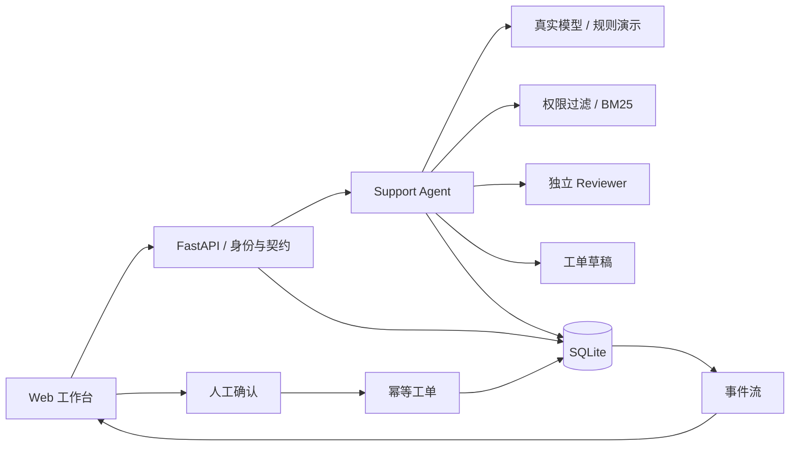

# Agent Workbench · 企业知识与工单协作

包含 Web 工作台、真实模型工具调用、独立审核、知识检索、引用、人工确认工单、持久化、测试及完整教程的 Python 项目。

**版本：1.0。** 默认规则演示无需 API Key；真实模式由你在本地配置后启用。[交付记录](docs/DELIVERY.md)列出验证范围。

## 立即启动

Windows 双击 [启动项目.bat](启动项目.bat)，或在根目录运行：

```powershell
.\scripts\start.ps1
```

打开 [本地工作台](http://127.0.0.1:8765)。需要 Python 3.11+，首次安装依赖需要网络。已有 .env 不会覆盖。

| 身份 | 用户名 | 密码 | 范围 |
| --- | --- | --- | --- |
| 员工 | employee | AgentDemo!2026 | acme 普通资料、自己的会话与工单 |
| 管理员 | admin | AgentAdmin!2026 | acme 资料管理、工单状态与审计 |
| 租户 B | beta | AgentBeta!2026 | beta 资料和自己的业务记录 |

账号和知识均为虚构演示。正式部署使用新数据库，关闭 APP_SEED_DEMO 并配置自己的管理员。

## 使用成品

1. 提问“VPN 连接失败，如何排查？”，展开引用，查看运行过程。
2. 问“VPN 月费”，观察资料相关但无答案时的处理。
3. 选择“生成工单草稿”，核对后确认，再到工单中心查看正式记录。
4. 管理员导入或编辑 Markdown / 文本资料，再检索新内容。
5. 管理员更新工单处理状态。
6. 打开学习中心阅读 16 章完整教程。

## 真实模型

编辑本地 .env，重启服务：

```dotenv
APP_MODE=live
LLM_BASE_URL=https://api.openai.com/v1
LLM_API_KEY=在本地填写
LLM_MODEL=你可用且支持工具的模型
LLM_REVIEW_ENABLED=true
```

接口采用 Chat Completions 风格，要求函数工具、required 工具选择和对应 Schema。提供商兼容性需实际验证。live 配置错误会明确失败，不会自动降级。

```powershell
# 将真实调用一次模型，可能产生费用
.\.venv\Scripts\python.exe -m agent_workbench check-model
```

本次没有真实模型凭据，因此尚未验证供应商实连与模型业务质量。

## 已实现模块

| 模块 | 能力 |
| --- | --- |
| 认证 | 密码哈希、随机会话、CSRF、租户/角色/资源所有权 |
| 知识库 | 导入、版本、字符分段、权限过滤后 BM25 |
| Agent | 有预算的工具循环、参数校验、重试、真实接口与规则演示 |
| 依据 | 原文与来源校验、独立审核、拒答与澄清 |
| 工单 | 明确意图、草稿、确认/拒绝、幂等、状态及审计 |
| 状态 | 历史会话、运行记录、SSE 阶段、断线回看、重启中断处理 |
| 交付 | 测试、两套合成评测、锁定依赖、CI、容器配置 |
| 教学 | 16 章教程、走读、实验、答案、修改与答辩指引 |

## 架构



代码：server.py 是 API，agent.py 是编排，providers.py 是模型协议，schemas.py 是契约，storage.py 是事务和状态，retrieval.py 是检索，auth.py 是密码与会话辅助，config.py 是配置；web/ 是前端，tutorials/ 是完整教材，acceptance.py 是完整流程验收。knowledge.py、workflow.py、evaluation.py 保留为 M0 对照。

学习入口：[教程第 00 章](agent_workbench/tutorials/00-start.md)、[全部章节](docs/roadmap.md)、[系统说明](docs/project-brief.md)、[架构决策](docs/decisions/0002-complete-application.md)。

## 验证与部署

```powershell
.\.venv\Scripts\python.exe -m pip install --require-hashes -r requirements-dev.lock
.\scripts\test.ps1
docker compose up --build -d
```

依赖由 pyproject.toml、uv.lock 与带哈希 requirements 文件管理。API 契约在 /openapi.json。容器需要运行中的 Docker 引擎，数据使用 workbench-data 命名卷；本地数据在 var/。

## 范围与边界

完整应用采用单进程 FastAPI、单机 SQLite、原生 Web。检索是词法 BM25，事件是阶段流，工单创建在本地数据库完成。语义 embedding、企业 SSO、分布式任务和第三方服务台属于后续集成。

重启会标记未完成任务失败，保留已完成草稿和工单。审核不能保证消除幻觉，合成通过率不代表真实用户效果。真实模型、实际数据和规模条件需单独验证。

参考：[OpenAI 工具调用](https://developers.openai.com/api/docs/guides/function-calling)、[Agent 评测](https://developers.openai.com/api/docs/guides/agent-evals)、[FastAPI](https://fastapi.tiangolo.com/)、[SQLite](https://docs.python.org/3/library/sqlite3.html)。
