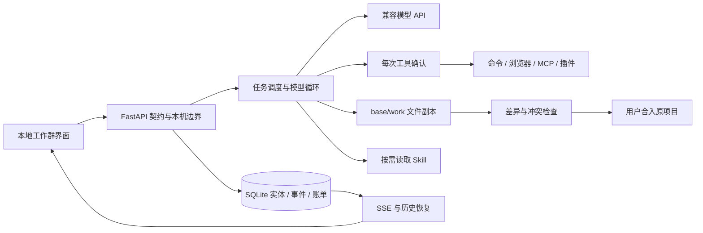

# v2 架构与数据流

浏览器发来的角色和模型文本不能增加权限。成员能力与项目归属在服务端检查，函数名白名单、Pydantic 参数、路径检查分别作用于不同边界。无登录适用于单用户本机；Host/Origin/页面写令牌减少跨站调用，不提供公网身份认证。

调度器最多同时运行三个任务，同一成员串行。依赖图只允许指向已经存在的任务；模型规划只能引用前序条目。计划采用在一个 SQLite 事务内创建全部草稿，点击开始后才进入队列。失败依赖不自动绕过。

任务先复制原项目为 base/work，再叠加依赖的已完成变更。base 是原项目基线，work 是该任务成果。合入比较原项目哈希与基线，并验证完成后产物未被改动；冲突时拒绝覆盖。正常 Python 异常会回滚本次写入，但整组文件不是跨进程、抗断电的原子事务。

模型每步只选择一个函数工具。外部执行前落库等待确认；完成后先保存工具结果，再进入下次模型调用。重启将未完成活动任务标记为 interrupted，待用户选择保留文件继续或重新执行；对执行到一半的外部副作用不做自动重放。

上下文包括项目说明、成员职责、入群成员、依赖报告、近期群聊与文件目录；完整文件按需读取。每次调用更新近期群聊和项目说明，旧工具长输出裁剪，但完整工具事件仍留在数据库。当前没有向量长期记忆或自动语义摘要。

模型真实用量由供应商 usage 返回。发起请求前按序列化上下文 UTF-8 字节数加余量估算输入，再加输出上限，事务预留额度；这只是保守启发式，不是所有供应商的精确 tokenizer。未知用量保留估算，停止后续调用不能撤销已产生的供应商费用。

API 路由、工具契约、数据库状态、模型适配、扩展执行和页面各自独立，方便未来替换框架。当前代码以透明可读为优先；没有引入 AutoGen/LangGraph 两套运行时再叠加自己的调度器。
