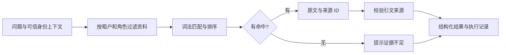

# 第 1 课：从问题到可核对的证据

这一课的目标：能够说明“VPN 连接失败”从输入到输出经过了什么，理解为什么运行成功还不能证明回答可靠。

## 先观察两次运行

在仓库根目录执行：

```powershell
python -m agent_workbench ask "VPN 连接失败" --json
python -m agent_workbench ask "火星基地停机坪坐标" --json
```

第一次应出现 `evidence_found`、`IT-001`、原文及 `trace`。
第二次应出现 `insufficient_evidence`，引用为空。
没有第三方依赖，没有模型推理，也没有网络请求。先把输入、资料、输出之间的关系观察清楚。

## 当前数据流



“可信身份上下文”表示由应用确定的身份信息。当前本地 CLI 的 `--role` 只是测试开关；正式服务不能允许用户随意指定自己是管理员。

## 按这个顺序读代码

1. `agent_workbench/models.py`：先看数据形状。`RequestContext` 是谁在提问，`Document` 是资料，`Citation` 是来源与引文，`Answer` 是返回结果。
2. `agent_workbench/knowledge.py`：看 `search()`。先做权限过滤，再分词、打分、排序。理解每一步输入和输出。
3. `agent_workbench/workflow.py`：看 `answer_question()`。这是当前的流程组织者，决定没有证据时停止，并校验返回的引用。
4. `agent_workbench/__main__.py`：看 `main()` 怎样把命令行参数转为应用输入，把结构化结果转为 JSON。
5. `tests/test_baseline.py`：每个测试表达一种必须保持的行为。
6. `agent_workbench/evaluation.py` 与 `data/eval_cases.json`：看系统怎样在一组固定样本上报告结果。

`dataclass` 自动生成初始化等常用方法；`frozen=True` 阻止正常属性重赋值，减少中途误改状态。
类型注解表达预期的数据类型，帮助阅读与静态检查；它们本身不会自动验证所有运行时输入，所以代码仍需进行必要检查。

## 六个关键概念

### 1. 检索与生成

检索从已有资料中找相关内容。生成由模型根据上下文组织回答。
当前只检索并原样展示内容，还没有生成阶段。

### 2. RAG

RAG 是 Retrieval-Augmented Generation，即检索增强生成。
典型流程是先检索，再把资料提供给模型作为上下文，最后生成回答。
它通常能提供知识依据，但仍可能检索错、引用错或过度推断，需要分别验证。

### 3. 工作流与 Agent

工作流由代码预先规定步骤；Agent 可以在约束范围内根据当前情况选择工具或下一步。
当前是固定的检索工作流。后续加入模型的动态工具决策，才会逐步具备 Agent 行为。
多个顺序函数或多个角色提示词，本身不足以证明多 Agent 带来价值。

### 4. 引用存在与依据充分

`validate_citations()` 检查文档 ID、标题、引文是否属于本次命中的原文。
它不能证明这段原文足以回答问题，更不能证明所有结论都正确。

试着问：

```powershell
python -m agent_workbench ask "VPN 月费"
```

它可能找到 VPN 资料，但资料没有费用信息。这是后续必须解决的“相关但没有答案”问题。
因此当前状态叫 `evidence_found`，表示找到相关资料，不能当作任务成功。

### 5. 测试与评测

测试检查明确约束，例如员工看不到管理员资料、伪造引用会被拒绝。
评测在一组任务上汇总系统表现，例如找对来源的比例、业务任务完成率、耗时和成本。
两者会重叠：当前测试也运行小型评测集，用于发现回归。
10 条合成用例只能证明这些用例的行为符合预期，不能证明处理真实用户的能力。

### 6. Trace

Trace 是一次任务的执行记录。当前用 `run_id` 标识一次运行，记录检索与引文校验阶段。
`elapsed_ms` 是从请求开始累计到该阶段的毫秒数，不是每个阶段独立的耗时。
未来还要记录模型调用、工具执行、token、停止原因与错误。不要把企业原始问题或资料默认写进日志。
当前 `--json` 包含回答原文，分享或保存整个返回结果前仍应考虑数据权限。

## 一次真实的调试例子

初始检索只计算正文与问题重合的词。
测试发现：“VPN 连接失败”除了命中 VPN 文档，也错误带出了密码重置文档，因为两篇都有“失败”。
修正方式是给标题中的匹配更高权重，削弱正文里偶然出现的通用词。

这说明：程序不报错，仍可能业务行为错误；精确引用集合的断言能发现“多返回一篇无关文档”的问题。
标题加权只是简单基线，后续仍需更广的数据和对照实验，不能据此断言检索问题已解决。

## 你的第一个练习

在虚构知识中添加一条“打印机无法打印”的资料，为它添加一条评测用例，然后运行测试和评测。
接着尝试回答：

- 为什么权限过滤放在内容返回之前？
- 为什么引用原文存在，仍不能证明问题已经解决？
- 如果错误地返回了两篇资料，应该先检查哪里？
- 修改检索算法后，如何发现旧问题又出现了？

你可以把修改或理解发来，我会结合具体代码讲解。这项练习不妨碍后续开发继续推进。

参考：[LangGraph 的工作流与 Agent](https://docs.langchain.com/oss/python/langgraph/workflows-agents)、[OpenAI function calling](https://developers.openai.com/api/docs/guides/function-calling)、[OpenAI Agent 评测](https://developers.openai.com/api/docs/guides/agent-evals)。
